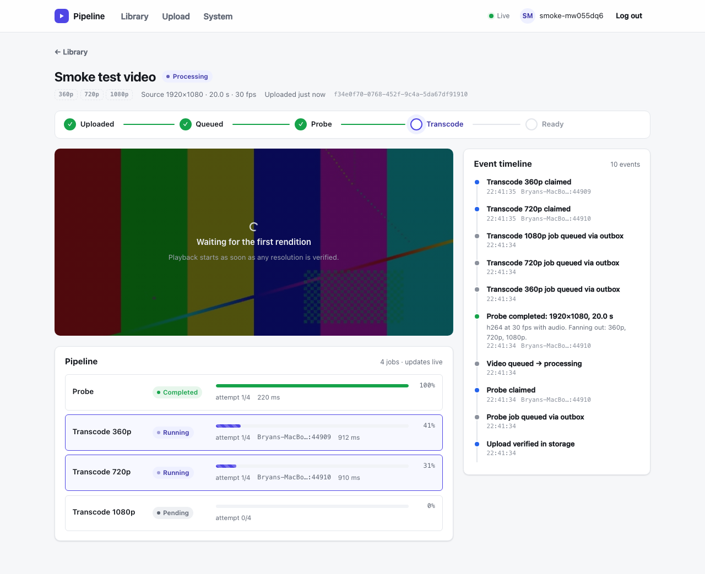
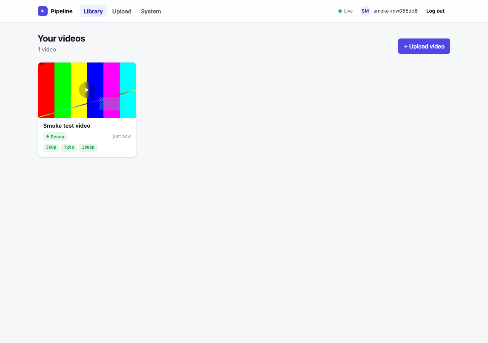
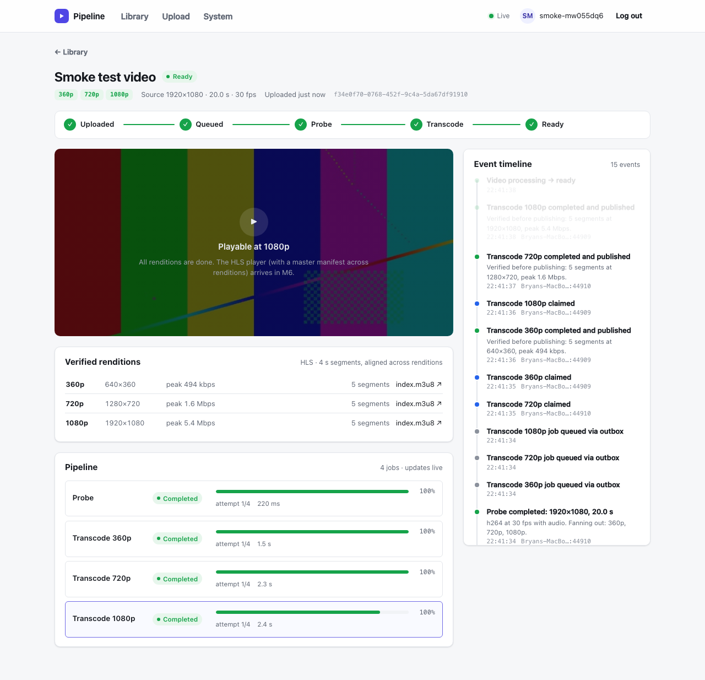
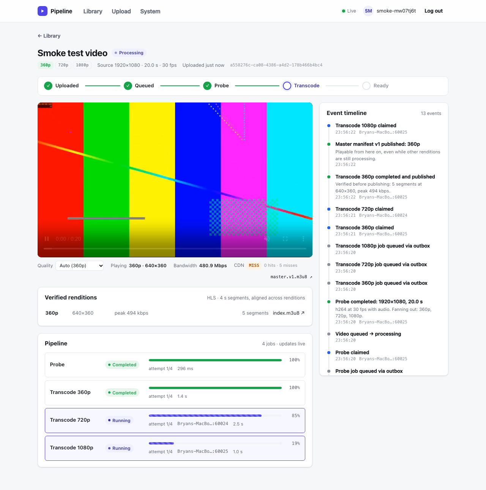
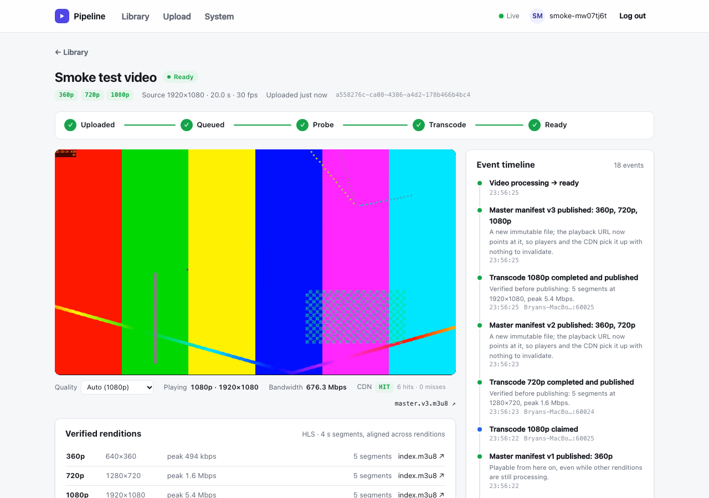
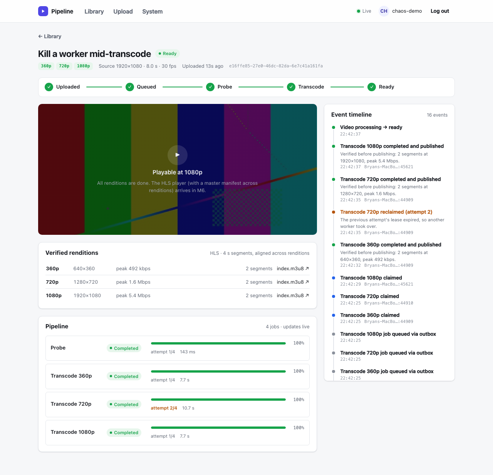
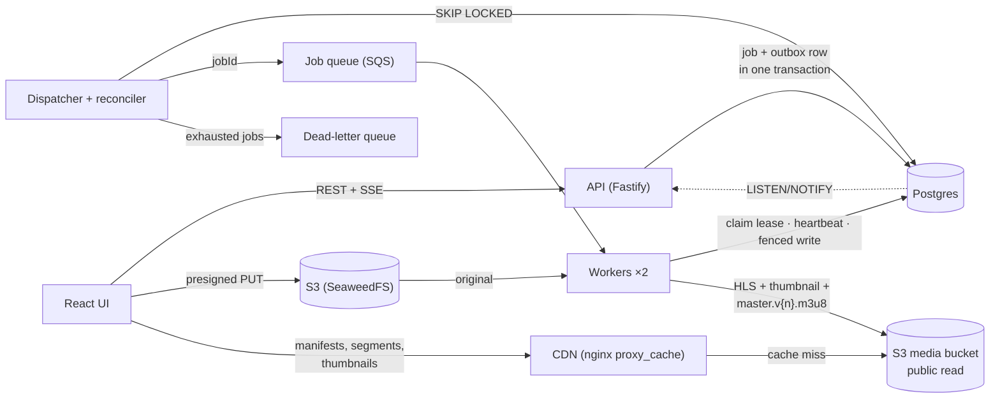

# Video Processing Pipeline

Upload → process → watch: a TypeScript implementation of the system design in [PROJECT_OVERVIEW.md](PROJECT_OVERVIEW.md). It covers a transactional outbox, queue-driven workers with fenced leases and heartbeats, real ffprobe/ffmpeg processing into verified HLS renditions, adaptive playback through a CDN from versioned manifests, retries with backoff and a dead-letter queue, a reconciler, idempotent APIs, and a React UI that shows the pipeline working live, including a chaos panel for breaking it on purpose. It's built milestone by milestone; see [docs/ROADMAP.md](docs/ROADMAP.md) for the full plan.



| Milestone | Status |
|---|---|
| M0 Scaffold (workspaces, Docker infra, migrations) | ✅ |
| M1 Create / upload / complete / status, idempotent create | ✅ |
| M2 Jobs, transactional outbox, dispatcher, placeholder worker, leases + fencing + heartbeat, SSE live events | ✅ |
| M3 React UI: login, library, upload with progress, live pipeline view + event timeline | ✅ |
| M4 Retries with backoff + jitter, dead-letter queue, reconciler, worker registry, chaos controls | ✅ |
| M5 Real media: ffprobe/ffmpeg HLS, thumbnails, verify-before-publish | ✅ |
| M6 Versioned manifests, playback API, CDN cache, hls.js player | ✅ |
| M7 Resumable multipart upload in the browser | ⏳ next |
| M8 Metrics panel + structured logging | |
| M9 Docker packaging, CI, docs, hosted demo | |

## The UI

| Upload: bytes go browser → S3 directly | Library: probe thumbnail, live status, playable resolutions |
|---|---|
|  |  |

**When it's done:** every rendition was verified (complete playlist, non-empty segments, decodes at the right size and length) and re-checked in storage before it was recorded. Segments are 4 s and line up across renditions.



### Watching: playback starts before processing finishes

As soon as the first rendition is verified, a master manifest is published and the player starts, here at 360p while 720p and 1080p are still encoding. Each later rendition publishes a new manifest version, and the player upgrades in place without losing its position. The bar under the video shows the quality menu, the bandwidth estimate, and where each segment came from: the CDN edge (**HIT**), storage via the CDN (**MISS**), or the browser's own cache (**BROWSER**).



**A second viewer** with an empty browser cache gets every segment from the edge (6 hits, 0 misses), because the first viewer already pulled them through. Storage served each one once.



### Breaking it on purpose: the System page

The System page shows live workers, queue/outbox/DLQ depths and fault-injection controls. Each control demonstrates one failure mode from the design.


| Transient failures: retried with backoff + jitter | Permanent failure: no retries, dead-lettered, operator retry |
|---|---|
|  |  |

**After killing a worker mid-transcode:** the worker and its ffmpeg died together, the lease expired without a heartbeat, another worker reclaimed the job, and attempt 2 re-encoded and published under its own `a2/` prefix.



## How it works (so far)



1. `POST /videos` creates the video and returns a presigned upload URL. The bytes go straight to storage.
2. `POST …/complete` checks the object in storage, then commits the `probe` job and its outbox row in one transaction.
3. The dispatcher sends due outbox rows to the queue, at least once.
4. A worker claims the job row, getting a lease and an attempt number that acts as a fencing token. It renews the lease while it works and commits results only if it still owns the job.
5. The **probe** runs ffprobe on the original: it rejects unreadable, too-long or too-small input permanently, extracts a thumbnail, and fans out a transcode only for each height the source supports (no upscaling).
6. Each **transcode** encodes HLS with a fixed GOP, so segments align across renditions, reporting live progress. It verifies the output, publishes it to `media/renditions/{video}/{height}/a{attempt}/`, re-checks the stored copy, and only then records the rendition.
7. In that same transaction it **publishes a master manifest**: a brand-new, immutable `master.v{n+1}.m3u8` listing every recorded rendition, then moves `videos.manifest_version` to it under the video row lock. The first finished rendition makes the video playable.
8. `GET /videos/:id/playback` returns the CDN URL of the current manifest, or `409 not_playable` with the status. The **hls.js player** fetches the manifest and segments from the **CDN**, an nginx edge cache in front of the media bucket, and reloads at the same position when a new manifest version arrives.
9. A failed attempt is **retried** with exponential backoff and jitter, up to 4 attempts. **Permanent** errors (corrupt input) skip retries. Either way, a job that ends up failed is **dead-lettered** through the outbox, in the same transaction that marks it failed.
10. The **reconciler**, inside the dispatcher, catches what the queue can't: running jobs whose worker died (lease expired), pending jobs whose message was lost, and dead worker registrations.
11. Every state change emits an event: a row in `job_events` plus `pg_notify`. The API streams these to the UI over SSE, and the UI refetches what changed.

## Layout

```
apps/web/          React + Vite UI: library, upload, live pipeline view, System page
apps/api/          Fastify HTTP API: routes → service → SQL; SSE event hub; /admin operator API
apps/dispatcher/   Outbox → queue relay + reconciler
apps/worker/       Queue consumer: claim, heartbeat, ffprobe/ffmpeg handlers, verification, retries, fault injection
packages/core/     Shared config, Postgres, S3, SQS, job state machine, domain types
migrations/        Plain .sql files, applied in filename order
infra/             Local S3 (SeaweedFS), SQS (ElasticMQ) and CDN (nginx) config
scripts/           dev supervisor, setup, test setup, test-clip generator, browser smoke test, chaos walkthrough
docs/              Roadmap and screenshots (architecture and demo docs come in M9)
```

## Running locally

Requires Node 24+, Docker and ffmpeg (`brew install ffmpeg` / `apt install ffmpeg`; the worker finds `ffmpeg` and `ffprobe` on `PATH`, or set `FFMPEG_PATH` / `FFPROBE_PATH`).

```sh
npm install
npm run infra:up     # Postgres :5433, S3 :8333, SQS :9324, CDN :8081
npm run setup        # apply migrations, create both buckets, backfill manifests (safe to re-run)
npm test             # integration tests (isolated DB, queue and bucket)
npm run dev          # UI :5173, API :3000, dispatcher, 2 workers (auto-restarting)
```

Open **http://localhost:5173**, pick any username, and upload a video. Anything ffmpeg can read works. A file that isn't a video fails the probe permanently, which is a quick way to see the dead-letter path. Need a test clip? `ffmpeg -f lavfi -i testsrc2=size=1920x1080:duration=20 -pix_fmt yuv420p clip.mp4`.

If you pulled this after M4, restart the S3 container once (`docker compose restart s3`) so it picks up the public-read rule for the media bucket. If you pulled it after M5, run `npm run infra:up` (it adds the `cdn` container) and `npm run setup` (migration 005, plus a master manifest for each video processed before M6).

- `npm run dev -- --workers 3` runs more workers. `npm run dev:web`, `dev:api`, `dev:worker` and `dev:dispatcher` each run one service with reload on change.
- The System page's **slow mode** throttles ffmpeg (5× = real time), so you have time to watch, or to kill a worker mid-encode.
- `npm run smoke:ui` (with the stack running) drives the UI in headless Chromium and saves screenshots to `./screenshots`. It checks that playback starts while the video is still processing, survives the manifest upgrades, switches quality on request, and that a second viewer gets CDN hits. Run `npx playwright install chromium` once first.
- `npm run demo:chaos` (with the stack running) walks through every failure scenario in the browser: retries, a permanent failure plus operator retry, a killed worker, a dispatcher outage, and a crash before commit. It asserts each one recovers. Start the stack with `JOB_LEASE_SECONDS=10 npm run dev` so lease expiries happen quickly.

### Walk through the pipeline with curl

```sh
# In one terminal: watch live events for user "alice"
curl -N localhost:3000/events -H 'x-user-id: alice'

# In another
ffmpeg -f lavfi -i testsrc2=size=1280x720:duration=10 -pix_fmt yuv420p /tmp/clip.mp4
SIZE=$(stat -f%z /tmp/clip.mp4)   # Linux: stat -c%s

curl -s -X POST localhost:3000/videos \
  -H 'x-user-id: alice' -H 'content-type: application/json' \
  -H 'idempotency-key: demo-1' \
  -d "{\"title\":\"Demo\",\"fileName\":\"clip.mp4\",\"fileSizeBytes\":$SIZE}"

curl -X PUT --data-binary @/tmp/clip.mp4 "<uploadUrl>"
curl -s -X POST localhost:3000/videos/<videoId>/uploads/<uploadId>/complete -H 'x-user-id: alice'

curl -s localhost:3000/videos/<videoId> -H 'x-user-id: alice'   # jobs + event timeline
curl -s localhost:3000/videos/<videoId>/playback -H 'x-user-id: alice'   # 409 until playable, then the CDN URL

curl -sI <playbackUrl> | grep -i x-cache-status   # MISS the first time…
curl -sI <playbackUrl> | grep -i x-cache-status   # …then HIT
```

`X-User-Id` is an auth stub for curl and tests. Browsers use the demo login cookie from `POST /session`. Either way, the server derives ownership; the request body never carries it.

## Things worth breaking on purpose

| Try this | What you'll see | Why |
|---|---|---|
| Re-send create with the same `idempotency-key` | Same `videoId`, header `idempotent-replayed: true` | Idempotency key table, scoped per user |
| Same key, different body | `422 idempotency_key_reused` | Request hash stored with the key |
| Call `/complete` twice | One probe job, same response | Conditional updates + `UNIQUE(video_id, kind, target_height)` |
| `/complete` before uploading | `409 upload_incomplete` | Storage is checked, not trusted |
| Upload fewer bytes than declared | Storage rejects the PUT | `Content-Length` is part of the signature |
| Upload a file that isn't a video | The probe fails on attempt 1 with "Not a readable video file"; no transcodes are created | ffprobe can't decode it: a `PermanentError`, never retried |
| Upload a 720p video | Only 360p and 720p are produced; the 1080p lane says "skipped: no upscaling" | The probe measures the source; fan-out commits with the probe's completion |
| **Kill** a busy worker on the System page (or `kill -9` its PID) | It shows as dead; its job is reclaimed as attempt 2 after one lease and the video still ends `ready` | Lease expiry + visibility timeout; the reconciler counts the lost attempt |
| Ctrl-C `npm run dev` while jobs are running, then start it again | The jobs are picked up immediately, not after a lease | Graceful shutdown releases the lease (fenced) and makes the message visible again |
| Set the **transient failure rate** to 60% | Jobs fail, show "retrying in 1.2 s", and mostly succeed on a later attempt | Exponential backoff with jitter; the outbox row only becomes due when the backoff ends |
| Set it to 100% | Each job fails 4 times, then lands in the dead-letter queue; **Redrive all** brings it back | Bounded retries; redrive raises `max_attempts` but never resets the attempt (fencing) number |
| Turn on **permanent failures** | Jobs fail on attempt 1 with no retries; a **Retry job** button appears | Corrupt input shouldn't be retried |
| **Pause the dispatcher**, then upload | The upload still succeeds; the video stays `queued` and the outbox backlog grows, then drains on resume | The job and its outbox row commit together; dispatch is decoupled |
| Open a video while it's still processing | The player starts at the first finished rendition; a toast says "Upgraded to manifest v2: 720p added" as the others land, and playback continues from the same position | One immutable manifest per published rendition; the pointer moves, the files never change |
| Keep an old `master.v1.m3u8` URL and fetch it after the video is `ready` | It still works and still lists one rendition | Nothing is overwritten, so a CDN can cache every manifest forever with nothing to invalidate |
| Watch the same video in a second browser (or a private window) | The CDN badge shows HIT for segments the first viewer already loaded | The edge fetched each segment from storage once; `proxy_cache_lock` collapses simultaneous misses into one fetch |
| `curl localhost:8081/videos/originals/<videoId>/source` | `403` | The CDN fetches anonymously, so it can only serve what storage itself makes public |
| **Arm one crash** | The next job's worker dies after publishing its output but before the DB commit; the job is redone as attempt 2 | "Output saved, database not updated": the `a1/` output is orphaned and never advertised; `a2/` is published and recorded |

## Notes and gotchas

- **S3 server:** MinIO no longer publishes community Docker images, so local S3 is SeaweedFS. The code is plain AWS SDK v3 and works unchanged against real S3.
- **Presigned URLs + AWS SDK checksums:** the S3 client sets `requestChecksumCalculation: "WHEN_REQUIRED"`. Without it, the SDK signs a CRC32 of an empty body into presigned PUT URLs, and every real upload fails with `BadDigest`.
- **Heartbeats aren't optional:** the first chaos run used jobs as long as the lease and no heartbeat, and it livelocked. Each attempt was reclaimed mid-run and then rejected by fencing (attempt 8 and counting). `apps/worker/test/heartbeat.test.ts` reproduces this with two competing workers.
- **Foreign keys take locks:** inserting a `job_events` row takes `FOR KEY SHARE` on its video. Recomputing the status with `FOR UPDATE`, which conflicts with that, deadlocked when two jobs finished at once. The UI smoke test caught it. The fix is `FOR NO KEY UPDATE`, and a regression test in `apps/worker/test/pipeline.test.ts` covers it.
- **Never abort a long-poll:** aborting `ReceiveMessage` mid-wait only closes the client's end. The queue can still hand the next message to that dead request and hide it for a full visibility timeout, which caused a 30 s stall after every restart. Workers now use 5 s polls and let them finish on shutdown.
- **Bucket CORS:** the browser PUTs straight to S3 from the UI's origin, so `npm run setup` applies a CORS rule (`CORS_ORIGINS`) to the bucket. The API itself needs no CORS, because the Vite dev server proxies `/api`.
- **Optimistic UI for controls:** the System page polls every second. Controlled toggles that only reflected polled state snapped back for up to a second after each click, which the chaos walkthrough caught. They now show the new value immediately and roll back if the save fails.
- **A locking CTE can see nothing:** detecting "this claim took over a dead worker's lease" first used `WITH prev AS (SELECT … FOR UPDATE)`. Postgres evaluates the CTE lazily, after the `UPDATE` has changed the row, and silently skips rows "updated by the current command" when locking, so it returned nothing. A plain `SELECT` reads the pre-statement snapshot, which is what's wanted. A test pins this down.
- **A rendition's "height" is a name, not a size.** 360/720/1080 are rungs on a ladder, measured on the short side so portrait video fits the same ladder. The first version stored only that and lost a portrait rendition's real 640 px height. A test caught it, and the actual output size is now stored separately.
- **ffmpeg children don't die with Node.** `process.exit` leaves spawned processes running. A simulated crash kills the worker's ffmpeg first, as a container crash would. A crashed attempt's scratch directory (under `WORK_DIR`, the OS temp dir by default) is left behind. Each attempt uses its own directory name, so leftovers never collide.
- **Public read is the storage's job.** The `media` bucket is readable anonymously because `infra/seaweedfs-s3.json` grants an `anonymous` identity `Read:media`, with no list and no write. The app never makes anything public itself, and `videos` (originals) stays private.
- **React effect cleanups run before the next effect.** The first manifest-upgrade version read the video's position at the start of the new effect, but the previous effect's cleanup (`hls.destroy()`) had already reset the `<video>` element to 0 and paused it. Every upgrade restarted the video. The UI smoke test caught it. The old player's cleanup now saves the position before destroying itself.
- **The browser cache sits in front of the CDN.** Segments are `immutable` for a year, so on a reload the browser serves them itself and replays the `X-Cache-Status: MISS` it saw the first time. The player separates the two with Resource Timing: if nothing was transferred, the browser served the segment. Cross-origin, that only works because the CDN sends `Timing-Allow-Origin`; without it `transferSize` always reads 0.
- **Concurrent manifest publication needs the row lock.** Without `FOR NO KEY UPDATE` on the video, two renditions finishing together both read version n and each publish an n+1 missing the other's rendition. `packages/core/test/manifests.test.ts` reproduces the race deterministically (it fails 3 runs out of 3 without the lock).
- **Postgres `bigint`** comes back from `pg` as a string, since JS numbers can't hold every 64-bit integer. It's converted explicitly where it's used.
