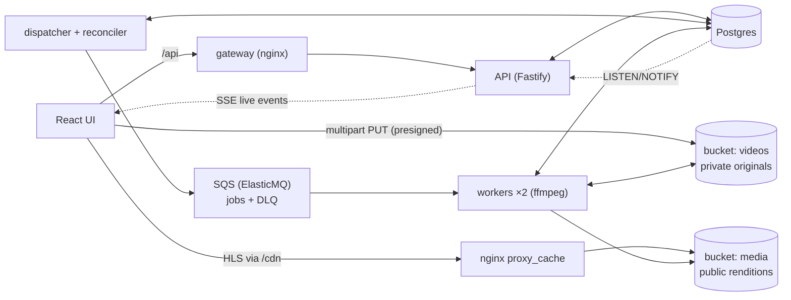

# Roadmap

This is how the design in [PROJECT_OVERVIEW.md](../PROJECT_OVERVIEW.md) becomes a finished, demoable system: a complete pipeline plus a small React UI that makes the system-design mechanics visible. Each milestone ends with green tests, an updated README table, and something new to see.

## The demo this builds toward

A ~60-second walkthrough:

1. Upload a video with a chunked progress bar.
2. Watch the probe job and the 360/720/1080 jobs move through the pipeline live.
3. 360p becomes playable while 1080p is still running.
4. Kill a worker mid-job. Its lease expires, another worker reclaims the job, and a late write from the dead attempt is rejected by fencing.
5. The video ends `ready` with adaptive playback.

## Target architecture

Key choices:

- **Live updates:** state changes write a `job_events` row and run `pg_notify` in the same transaction. The API holds one `LISTEN` connection and fans events out to browsers over Server-Sent Events. Events are hints to refetch, never state, the same principle as queue messages.
- **Two buckets:** originals stay private and are reachable only through presigned URLs. Renditions, thumbnails and manifests are public-read and served through the CDN.
- **Presign host:** `S3_PUBLIC_ENDPOINT` is the browser-reachable S3 URL, used only when signing. Signatures cover the host, so it can't be a path prefix behind nginx.
- **Demo login:** `POST /session` sets a signed cookie, because `EventSource` can't send custom headers. `X-User-Id` still works for tests and curl.
- **Chaos as data:** a `chaos_settings` row controls injected failures. "Kill worker" makes the worker hard-exit mid-job, and the supervisor restarts it.

## Milestones

| # | Milestone | Status |
|---|---|---|
| M0 | Scaffold: workspaces, Docker infra, migrations | ✅ |
| M1 | Create / upload / complete / status, idempotent create | ✅ |
| M2 | Jobs + transactional outbox + dispatcher + placeholder worker, leases/fencing/heartbeat, live events (SSE), dev supervisor | ✅ |
| M3 | React UI v1: login, library, upload, live pipeline view | ✅ |
| M4 | Retries with backoff + jitter, error classification, DLQ, reconciler, chaos controls | ✅ |
| M5 | Real media: ffprobe validation, thumbnails, ffmpeg HLS, progress, verify-before-publish | ✅ |
| M6 | Playback: versioned manifests, CDN cache, playback API, hls.js player | ✅ |
| M7 | Resumable multipart upload in the browser | |
| M8 | Metrics panel + structured logging | |
| M9 | Docker packaging, CI, Playwright smoke, docs, hosted deploy | |

### M2: Jobs, outbox, dispatcher, placeholder worker ✅
- `/complete` creates the `probe` job, its outbox row and a timeline event in the same transaction as the status change.
- The dispatcher sends due outbox rows using `FOR UPDATE SKIP LOCKED`. Delivery is at-least-once.
- The worker receives a message, claims the job with a fenced lease, runs a placeholder handler and writes a fenced result. The probe fans out the transcode jobs.
- A heartbeat renews the DB lease and the SQS visibility every lease/3, and abandons the work if the lease is lost. It was pulled forward from M4 after a chaos run livelocked without it.
- API: `GET /videos`, `GET /videos/:id`, `GET /events` (SSE), `POST|GET|DELETE /session`.
- `npm run dev` runs a supervisor for the API, the dispatcher and 2 workers, with auto-restart.

### M3: React UI v1 (`apps/web`) ✅
- Vite + React + TS. Plain CSS modules and no component library.
- **Login:** pick a demo username.
- **Library:** grid with thumbnail, title, status badge and resolution chips, updated live.
- **Upload:** drag and drop, single PUT with a progress bar.
- **Video detail:** one lane per job showing state, attempt `n/max`, progress, worker and last error, with an event timeline below.
- A typed API client and a `useLiveQuery` hook: fetch, then refetch on matching SSE events, coalesced and protected against out-of-order responses. Response types come from `@vpp/core/domain`, a browser-safe entry point, so the UI and API share one definition.
- Bucket CORS was pulled forward from M7, since the browser PUTs straight to S3. `GET /session` became public and returns `null` when logged out, so first load logs no 401s.
- `npm run smoke:ui` drives the real UI in headless Chromium. Its first runs found three backend bugs, all fixed with regression tests:
  - **Deadlock:** the FK lock from inserting a `job_events` row conflicted with the `FOR UPDATE` in `recomputeVideoStatus`, so two jobs finishing at once deadlocked. Fixed with `FOR NO KEY UPDATE`.
  - **Zombie long-polls:** aborting `ReceiveMessage` during shutdown let the queue hand the next message to a dead request, hiding it for a whole visibility timeout. Workers now use 5 s polls and never abort one.
  - **Slow handoff on shutdown:** a worker stopped mid-job now releases its lease (fenced) and makes the message visible again, so another worker resumes the job immediately.

### M4: Reliability and chaos controls ✅
No new components. As `PROJECT_OVERVIEW.md` specifies, the reconciler runs inside the Background Dispatcher, failed work goes to a dead-letter queue, and chaos controls are internal `/admin` endpoints backed by Postgres.

- **Error classification:** `PermanentError` (corrupt or unsupported input) fails at once. Everything else is treated as retryable, bounded by `max_attempts = 4` ("three retries means up to four attempts").
- **Retries:** a retryable failure returns the job to `pending` with `next_attempt_at = now() + backoff`, plus an outbox row whose `available_at` is the same moment. The backoff is exponential with *equal* jitter: half the delay is guaranteed, so delays really increase, and half is random, to spread out retry storms.
- **Dead-letter queue:** `outbox.queue` can be `jobs` or `dead-letter`, so dead-lettering commits atomically with marking the job failed. The ElasticMQ redrive policy remains a backstop for poison messages.
- **Redrive:** `POST /admin/jobs/:id/retry` handles one job, and `POST /admin/dlq/redrive` drains the DLQ. Both raise `max_attempts`; the `attempt` counter, which is the fencing token, is never reset. Redriving twice is a no-op.
- **Claims** refuse jobs that are out of attempts, and record whether they took over a dead worker's expired lease. The timeline flags those takeovers.
- **Reconciler**, inside the dispatcher, runs every 2 s with `SKIP LOCKED`:
  - Expired leases count as a failed attempt, so the job retries or is dead-lettered.
  - Overdue pending jobs with no unsent outbox row are re-queued.
  - Dead worker registrations are reaped.
- **Worker registry:** a `workers` table with a 1 s heartbeat that reports the current job and delivers kill requests.
- **Chaos settings:** a single `chaos_settings` row, read by every worker and the dispatcher:
  - Transient failure rate.
  - Permanent failures.
  - Slow mode.
  - Pause dispatcher.
  - "Crash the next N jobs before commit": an atomic one-shot counter.
- **UI:** a System page with:
  - Stat tiles: outbox backlog, job queue, DLQ with **Redrive all**, and jobs by state.
  - Workers with Kill buttons.
  - Fault-injection controls with optimistic updates.
  
  The video page gains retry countdowns, an error-kind label, a **Retry job** button on failed jobs, and timeline entries for every new event type.
- `npm run demo:chaos` drives all five failure scenarios through the browser and asserts each one recovers. Running it found two more bugs, both fixed with tests:
  - Toggles snapped back until the next poll.
  - A `FOR UPDATE` in a CTE made takeover detection silently return nothing.

### M5: Real media processing ✅
No new components: workers read the original from Blob Storage and write outputs back to it, the "Workers ↔ Storage" edge in `PROJECT_OVERVIEW.md`. Every M2–M4 mechanism (claim, fencing, heartbeat, retries, DLQ, chaos) is unchanged.

- **Two buckets:** originals stay in the private `videos` bucket. Renditions and thumbnails go to a public-read `media` bucket (a SeaweedFS anonymous identity with read access to that bucket only: no list, no write). `MEDIA_PUBLIC_URL` is the browser-facing base URL, which M6 points at the CDN.
- **Probe:** downloads the original and runs ffprobe. Unreadable input, no video stream, a duration over 30 min, or a source below 360p is a `PermanentError`, so there are no retries. It extracts a thumbnail, stores the source's size, duration and frame rate on the video, and fans out only heights at or below the source (the short side, so portrait video fits the same ladder). All of that commits in one fenced transaction.
- **Transcode:** ffmpeg to HLS with 4 s segments and a fixed 2 s GOP at a constant frame rate (`-g`, `-keyint_min`, `-sc_threshold 0`), so segment boundaries line up across renditions. Progress comes from `-progress pipe:1`, throttled to about 3 writes/s.
- **Verify before publish:**
  1. Locally: the playlist has `#EXT-X-ENDLIST`, every segment exists and is non-empty, and ffprobe decodes the output at the right size and duration.
  2. The worker uploads to `renditions/{videoId}/{height}/a{attempt}/`, segments first and the playlist last.
  3. It lists the stored copy and checks every size.
  
  Only then does it insert the `renditions` row. That row records the peak segment bit rate (HLS `BANDWIDTH`) for M6's master manifest.
- **Chaos with real work:** slow mode throttles ffmpeg with `-readrate 5/slowFactor` (5× = real time). A kill or crash also kills the worker's ffmpeg children, as a container crash would.
- **Tests:** the M2 placeholder handlers became test doubles (`apps/worker/test/fake-handlers.ts`), swapped in like `runtime.crash`, so the job-machinery tests stay fast. New real-media tests use clips generated with ffmpeg `testsrc2` (`scripts/clip.ts`, pulled forward from M9's seed script). They cover:
  - Segment alignment.
  - Verification rejecting truncated or empty output.
  - Abort killing ffmpeg.
  - The 1080p, 720p and portrait ladders.
  - Corrupt and too-long uploads failing permanently.
- **UI:**
  - Real thumbnails in the library and as the player poster.
  - Source info in the header.
  - Lanes marked "skipped: source is 720p: no upscaling".
  - A "Verified renditions" panel with output size, peak bit rate, segment count and playlist link.
  - Timeline entries saying what the probe found and what each transcode verified.
- **Deferred to M9:** the worker Docker image (`node:24-bookworm-slim` + ffmpeg). Locally the worker uses ffmpeg from `PATH` (`FFMPEG_PATH` / `FFPROBE_PATH` override it), and `npm run dev` checks for it up front.
- The portrait test found a modeling bug before it shipped: `renditions.height` is the rung's name (the short side), so a portrait rendition lost its real pixel height. The fix stores `output_width`/`output_height` separately. `npm run smoke:ui` and `npm run demo:chaos` both pass with real encodes, including a worker killed mid-encode and a crash after publishing but before the DB commit.

### M6: Playback and CDN ✅
This completes the "Watch" path in `PROJECT_OVERVIEW.md`: Client → CDN → Blob Storage, with the API only saying where to play from. The CDN was already a component in that diagram; nginx stands in for it.

- **Versioned manifests** (`packages/core/src/manifests.ts`): the transaction that records a rendition also writes a brand-new `renditions/{videoId}/master.v{n+1}.m3u8` and moves `videos.manifest_version` (migration 005) to it, under the video row lock (`FOR NO KEY UPDATE`).
  - The file is uploaded before the pointer commits, so the pointer never references a missing object. A rolled-back upload is an orphan nobody was pointed at.
  - Variants list the stored peak `BANDWIDTH`, the real `RESOLUTION` and the `FRAME-RATE`, with URIs relative to the master. `EXT-X-INDEPENDENT-SEGMENTS` holds because of M5's fixed GOP.
  - A `manifest_published` event goes on the timeline. `npm run setup` backfills manifests for videos processed before M6.
- **CDN** (`cdn` in docker-compose, `infra/nginx-cdn.conf`): nginx `proxy_cache` in front of storage on `:8081`.
  - It honors storage's `immutable, max-age=1y`, so nothing is ever invalidated.
  - `proxy_cache_lock` collapses simultaneous misses into one origin fetch, and `use_stale` keeps serving during a storage outage.
  - It is read-only and fetches anonymously, so it can only serve the public media bucket. Originals return 403.
  - It answers CORS itself and sends `X-Cache-Status` and `Timing-Allow-Origin`.
  - `MEDIA_PUBLIC_URL` now defaults to `${CDN_URL}/${MEDIA_BUCKET}`, so thumbnails and the tests go through it too.
- **API:** `GET /videos/:id/playback` returns `{ playbackUrl, manifestVersion, availableResolutions, status }`, or `409 not_playable` with the status. `VideoDetail` gains `manifestVersion`.
- **Player** (`apps/web/src/components/Player.tsx`, hls.js light build, lazy-loaded with the video page):
  - A quality menu (Auto plus each rung) and the current level.
  - The bandwidth estimate.
  - Where each segment came from: CDN HIT, MISS, or the browser's own cache.
  - When the detail's `manifestVersion` bumps over SSE, it refetches `/playback`, reloads at the same position, keeps playing and keeps a pinned quality.
- **Tests:**
  - The manifest builder.
  - A deterministic race between two publishing transactions, which fails without the lock.
  - End to end: 409 before playable; manifest v1 with one rendition while the video is still `processing`; v3 through the CDN, MISS then HIT, every variant resolving to its verified rendition; old versions unchanged.
- **Browser verification:** `npm run smoke:ui` now plays the video. Its first run found a real bug: React runs the previous effect's cleanup (`hls.destroy()`, which resets the `<video>`) before the next effect reads the position, so every manifest upgrade restarted playback at 0. The old player's cleanup now saves the position.
  - The next run showed that a reload's "MISS" badges came from the **browser** cache replaying the first response's header. That led to the three-way segment source.
  - `npm run demo:chaos` still passes all five scenarios. After it, every video's current manifest matches its recorded renditions exactly, including retried `a2/` and `a3/` outputs, and never an orphan.

### M7: Resumable multipart upload
- Every upload is a multipart upload with 8 MiB parts.
- `POST /videos/:id/uploads/:uploadId/parts` lists the parts already in storage, since storage is authoritative, and presigns URLs only for the missing ones.
- The browser uploads 4 parts concurrently and retries each part independently. It shows a per-part grid and resumes after a refresh, using `localStorage` and re-selecting the same file.
- Bucket CORS is set through `PutBucketCors`, which needs a spike first. Abandoned uploads expire through a lifecycle rule.

### M8: Metrics and observability
- `GET /admin/metrics` reports:
  - Queue and DLQ depth.
  - Jobs by state.
  - Oldest pending age.
  - Throughput.
  - p50/p95 job duration.
  - Live workers.
- The same data is exposed in Prometheus text format at `/metrics`.
- The UI shows stat tiles with sparklines.
- Logging uses pino with child loggers bound to `videoId` / `jobId` / `attempt`.

### M9: Packaging, CI, docs and deploy
- One multi-stage Dockerfile. The worker stage is `node:24-bookworm-slim` plus ffmpeg (moved here from M5). The compose `app` profile adds the API, the dispatcher, 2 workers and an nginx gateway. `npm run demo` starts everything at `http://localhost:8080`.
- `scripts/seed.ts` generates a 1080p test clip with ffmpeg `testsrc2`, so no binaries are committed.
- GitHub Actions runs the typecheck, the tests with real containers, and a Playwright smoke test.
- Hosted mode (`DEMO_PUBLIC=true`) adds:
  - Caddy for TLS.
  - Upload caps.
  - Rate limits.
  - Chaos auto-reset.
  - 24 h cleanup of uploaded videos.
- New docs: `docs/ARCHITECTURE.md` (sequence diagrams and a failure-mode table), `docs/DEMO.md` (an interview walkthrough) and `docs/DEPLOY.md`. The README is rewritten as a portfolio landing page.
